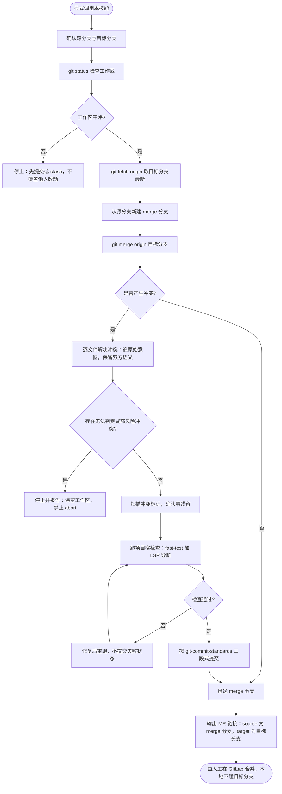

# 合并冲突走 merge 分支 + MR

## 核心规则

本技能固化团队的分支保护流程：**任何人都不得把本地分支直接推到 `develop` / `master`，冲突必须在临时 merge 分支上解决，最终由 GitLab 通过 MR 完成合并。**

<HARD-GATES>

1. **禁止推送受保护分支**：`git push origin develop`、`git push origin master`、`git push --all` 一律拒绝；只能推 `<merge 分支>`。用户即使要求直接推，也要先说明本技能的红线并改用 MR。
2. **必须在新建的 merge 分支上解冲突**：源分支保持原样（不 rebase、不 merge、不 reset），便于回退与对照。
3. **合并方向固定**：`merge 分支 ← 目标分支`。不允许把源分支内容直接写入目标分支再“顺手修”。
4. **禁止 `git merge --abort`、`git reset --hard`、`git push --force`**：解决不了就停止并报告，保留工作区。
5. **未通过项目检查不提交**：冲突解决后必须跑本项目的窄检查，失败则修好再提交。
6. **不自动触发**：仅在用户显式调用时执行；不进入任何自动路由链。

</HARD-GATES>

## 分支命名

格式：`merge.<用户名>.<源分支末段>2<目标分支>`

| 占位符 | 取法 | 示例 |
|---|---|---|
| `<用户名>` | `git config user.name` | `zenghui` |
| `<源分支末段>` | 源分支名按 `.` 或 `/` 分割取最后一段 | `feature.zh.1083416.后端重复提交校验` → `后端重复提交校验` |
| `2` | 固定字面量，表示 to | `2` |
| `<目标分支>` | 目标分支名，去掉 `origin/` 前缀 | `develop` |

示例：源分支 `feature.zh.1083416.后端重复提交校验` + 目标 `develop`
→ `merge.zenghui.后端重复提交校验2develop`

若分支名含中文导致远端或 CI 拒绝，改用源分支末尾的英文/数字段（如 `1083416`），并在报告中说明替换原因。

## 执行流程



### 命令序列

```bash
# 1 准备：确认身份与状态
git branch --show-current
git status --short
git fetch origin --prune

# 2 记录源分支基线（报告里引用）
git rev-parse HEAD

# 3 新建 merge 分支（源分支保持不变）
git checkout -b "<merge 分支>" "<源分支>"

# 4 目标分支合入 merge 分支
git merge "origin/<目标分支>"

# 5 冲突清单
git status --short
grep -rn "^<<<<<<< " src/ || echo "无冲突标记"

# 6 解决后校验：见「校验」节（Java 项目 = fast-test 增量编译 + 单测、LSP 诊断）

# 7 提交（提交信息走 git-commit-standards 三段式）
git add -A
git commit -F .git/team-standards/COMMIT_MESSAGE

# 8 只推 merge 分支
git push -u origin "<merge 分支>"
```

### GitLab MR 链接模板

```text
<remote-http-url>/-/merge_requests/new?merge_request%5Bsource_branch%5D=<urlencode merge 分支>&merge_request%5Btarget_branch%5D=<目标分支>
```

推送成功后 GitLab 通常会在远端输出里回显该链接，直接转给用户即可；否则按上面模板拼接（分支名需 URL 编码）。

## 冲突解决细则

与 `mattpocock/skills@resolving-merge-conflicts` 的流程保持一致；未安装该技能时按本节执行：

1. **先看状态**：`git status`、`git log --oneline -5`、冲突文件清单，判断这是 merge 还是 rebase 中途。
2. **追原始意图**：对每处冲突，读双方的 commit message、相关 MR / TAPD 单、原始需求；不理解双方为什么改，不许动手删任何一边。
3. **逐 hunk 解决**：
   - 双方改动互不冲突时**两边都保留**；
   - 语义冲突时按「本次合并要达成的目标」取舍，并在提交正文或报告中写明取舍理由；
   - **绝不发明新行为**、绝不顺手重构、绝不删除看不懂的代码。
4. **逐文件推进**：一次只处理一个文件，处理完 `git add <file>`，避免一次性全改。
5. **大文件优先抽 hunk**：文件超过数百行且多处冲突时，只抽取冲突段与上下文对比，不整文件重写；具体命令见下节「大文件冲突：按索引阶段取版本」。
6. **无法判定就停**：涉及金额、状态机、权限、跨服务契约且无法确认意图时，停止并给出「冲突位置 + 双方意图 + 建议方案」交人工决策。

### 大文件冲突：按索引阶段取版本

替代外部脚本的等价手工命令，适用于 `OrderDecorator` 这类数千行文件多处冲突：

```bash
# 1 只看尚未解决的文件
git diff --name-only --diff-filter=U

# 2 看单个文件的组合 diff：同时给出双方差异，不必打开整文件
git diff --cc <file>

# 3 定位冲突块行号，只读这些区间与上下各 20 行
grep -n "^<<<<<<< \|^=======$\|^>>>>>>> " <file>

# 4 需要看某一侧完整实现时，按索引阶段取版本（不改动工作区）
git show :1:<file> > /tmp/base.txt     # 共同祖先版本
git show :2:<file> > /tmp/ours.txt     # 当前分支（merge 分支来源）版本
git show :3:<file> > /tmp/theirs.txt   # 目标分支版本

# 5 只对比两侧差异，控制输出量
git diff --no-index /tmp/ours.txt /tmp/theirs.txt | head -200
```

约定：

- `:1:` / `:2:` / `:3:` 三个 blob 只在冲突未解决期间存在，`git add <file>` 后即消失；需要留档先复制。
- 只读冲突区间及其上下文，禁止整文件读入后整体重写；每解决一个文件立刻 `git add <file>`，缩小后续冲突面。
- 全部解决后复查：`grep -rn "^<<<<<<< \|^>>>>>>> " src/` 无输出，且 `git diff --cached --check` 无空白错误。

## 校验

按项目规范执行，本仓库（mall-extend-service）默认：

| 项目类型 | 校验 |
|---|---|
| Java / Maven | `fast-test -Test <相关测试>` 增量编译并执行单测；LSP（jdtls）对修改文件跑 `diagnostics`、`symbols` 抽查 |
| LSP 不可用 | 降级为 fast-test 精准编译（javac 只编改动文件），并在报告中注明降级原因 |
| 前端 / 其它 | 项目既有 lint / typecheck / 单测命令 |

校验失败不得提交；修好重跑，直到通过。禁止把「未验证」的状态推进远端。

## 完成前自检

- [ ] merge 分支名符合 `merge.<用户名>.<源分支末段>2<目标分支>`
- [ ] 源分支未被改动（无 merge/rebase/commit 痕迹）
- [ ] 目标分支仅被 `fetch` 读取，**本地零推送**
- [ ] `grep -rn "^<<<<<<< " src/` 无输出，且无 `=======` / `>>>>>>>` 残留
- [ ] 冲突解决依据已记录（引用 commit / MR / TAPD）
- [ ] 项目检查通过
- [ ] 提交信息符合 `git-commit-standards` 三段式
- [ ] 只推送 merge 分支，并已输出 source=merge 分支、target=目标分支 的 MR 链接

## 失败模式与处理

| 现象 | 处理 |
|---|---|
| 工作区有未提交改动 | 停止，要求先提交或 stash；不覆盖用户改动 |
| merge 分支已存在（同名） | 不覆盖、不删除；报告并请求换名（加序号或换末段） |
| 目标分支在解决期间又更新 | 重新 `git fetch origin` 后再 `git merge origin/<目标分支>` 一次，不 reset |
| 冲突属于同一行的语义冲突 | 按「目标」取舍并记录理由；不能确定就停止上报 |
| 中文分支名推送被拒 | 换成数字/英文末段重推，报告原因 |
| 推送被保护规则拒绝 | 停止并报告，禁止 `--force` |
| 项目检查环境不可用 | 记录降级手段与缺口，交由用户决定是否继续 |
| 用户要求直接推 develop | 拒绝并说明：本技能只走 merge 分支 + MR |

## 本地护栏（可选安装）

在开发机启用全局 `pre-push`，拦截直推受保护分支的误操作：

```bash
# 安装（hook 文件位于 ~/.githooks/pre-push）
git config --global core.hooksPath "$HOME/.githooks"

# 卸载
git config --global --unset core.hooksPath
```

hook 行为：

- 推送目标为 `refs/heads/develop`、`refs/heads/master` 时直接 `exit 1`，并提示改走 merge 分支 + MR；
- 受保护分支列表可用环境变量覆盖：`export PROTECTED_BRANCHES="develop master release/*"`；
- 默认**不拦 `main`**（个人仓库日常直推 main 属正常）；
- 会链式调用 `<git-dir>/hooks/pre-push.local`，项目自有 hook 放该文件，避免被全局 `core.hooksPath` 吞掉。

限制（必须知道）：

- 本地 hook 可被 `git push --no-verify` 绕过，**真正的护栏是 GitLab 的 Protected Branches**：把 `develop` / `master` 设为 *No one can push* 或 *Only maintainers can merge*，否则任何绕过手段都能直推。
- `core.hooksPath` 会让仓库 `.git/hooks` 下的普通 hook 失效，安装前先确认目标仓库是否有自定义 hook。

## 与其它技能的关系

| 技能 | 关系 |
|---|---|
| `mattpocock/skills@resolving-merge-conflicts` | 第 4 步冲突解决的执行细则来源；本技能在其上加分支策略与推送护栏 |
| `git-commit-standards` | 第 7 步提交信息格式，禁止 AI 署名 |
| `test-release-doc` | 合入前生成提测文档 |
| `review-platform` | MR 创建后的平台评审跟进 |
| `daily-work-log` | 冲突解决涉及业务代码改动时登记当天工作日志 |